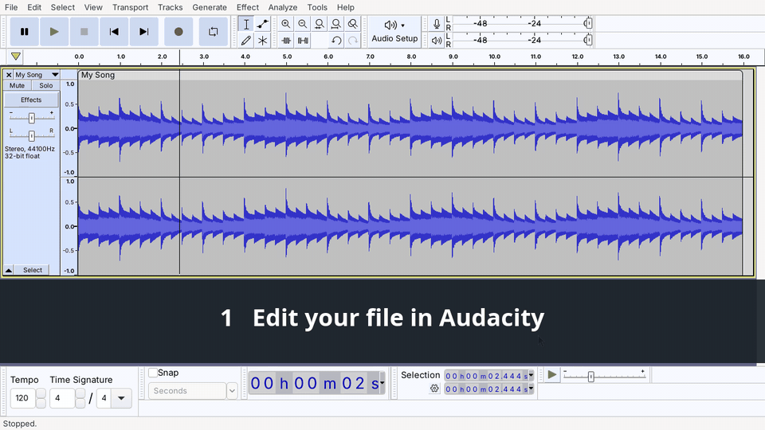

# Audacity Quick Save

**A real "Save" for Audacity on Linux.** Press one shortcut and the audio you are editing is written back over the original file, in the same format, with the same quality settings, tags and cover art. A backup of the previous version is kept automatically.



[Leggi in italiano](README.it.md)

---

## Why

Audacity is a non-destructive editor. When you open an MP3, it imports a copy, and the only way to get your edits back into the file is **File > Export Audio**, choosing the folder, the name, the format and its options every single time, then confirming the overwrite.

This has been requested on the Audacity forum for years, and it still is not built in. Audacity Quick Save fills the gap.

## What it does

- **One shortcut, no dialogs.** Ctrl+Alt+S by default.
- **Keeps the original characteristics**: format, codec, bitrate (CBR or VBR), sample rate, bit depth, channels.
- **Keeps the metadata**: tags, cover art, chapters, ID3 version.
- **Lossless where it matters**: the audio leaves Audacity as 32-bit float, so WAV, FLAC and other lossless files are saved bit-exact when untouched.
- **Never loses your file**: the previous version goes to a backup folder (last 20 kept), and the original is replaced atomically.
- **English and Italian** messages, chosen from your system language.

### Supported formats

| Format | Codec | Notes |
|---|---|---|
| MP3 | LAME | CBR bitrate kept exactly; VBR quality read from the LAME header when present; ID3v2.3/2.4 and ID3v1 kept |
| FLAC | FLAC | 16 or 24 bit |
| WAV, AIFF, W64 | PCM | same sample format (16/24/32 bit, float) |
| M4A / MP4 | AAC, ALAC | HE-AAC needs an ffmpeg with libfdk_aac, otherwise LC is used |
| OGG | Vorbis | |
| OPUS | Opus | |
| WV | WavPack | |
| MP2, AC3, WMA | | basic support |

Files with more than 2 channels are not supported yet.

## Requirements

- Linux (tested on Ubuntu 24.04 with GNOME, Audacity 3.4.2 from apt and 3.7.8 from Flathub)
- **Audacity 3.x** with the `mod-script-pipe` module (included in the Ubuntu/Debian packages and in the official builds)
- Python 3.8 or newer (preinstalled on most distributions)
- ffmpeg and ffprobe: `sudo apt install ffmpeg`

> Audacity 4 no longer ships `mod-script-pipe`, so it is not supported for now.

## Installation

```bash
git clone https://github.com/aixygen/audacity-quicksave.git
cd audacity-quicksave
./install.sh
```

The installer copies the script to `~/.local/bin` and, on GNOME, creates the **Ctrl+Alt+S** keyboard shortcut. Use another key with `./install.sh --shortcut '<Super>s'`, or skip it with `--no-shortcut` and bind `~/.local/bin/audacity-quicksave` yourself in your desktop's keyboard settings (KDE, XFCE, Cinnamon...).

Then **enable the scripting module once**:

1. Open Audacity
2. Go to **Edit > Preferences > Modules**
3. Set **mod-script-pipe** to **Enabled**
4. Restart Audacity

## Usage

1. Open an audio file in Audacity (File > Open, double click, drag and drop)
2. Edit it
3. Press **Ctrl+Alt+S**

A notification confirms the save, for example *Saved song.mp3, MP3 320 kbps, 44.1 kHz, stereo*.

You can also run `audacity-quicksave` from a terminal.

### Backups

Every save copies the previous version to `~/.local/state/audacity-quicksave/backups`, named with date and time. The 20 most recent are kept.

`.local` is a hidden folder, so you will not see it in your file manager by default. To open the backups folder directly:

```bash
xdg-open ~/.local/state/audacity-quicksave/backups
```

Or, in your file manager, press **Ctrl+L**, paste `~/.local/state/audacity-quicksave/backups` and press Enter. To change the folder or the number of backups, copy [`config.example.ini`](config.example.ini) to `~/.config/audacity-quicksave/config.ini`.

## How it works

1. Audacity's `mod-script-pipe` lets other programs send commands to Audacity through two named pipes. The shortcut connects to them only for the time of the save.
2. The script finds the original file in Audacity's *Recent Files* list, matching it against the track names of the active project.
3. It reads the original's characteristics with `ffprobe`.
4. It tells Audacity to export the whole project to a temporary 32-bit float WAV next to the original, at the original sample rate.
5. `ffmpeg` re-encodes that WAV with the original codec and settings, copying tags and cover art from the original.
6. The original is backed up, then replaced in a single atomic rename.
7. The script disconnects. This matters: while a script stays connected, Audacity cannot quit cleanly.

## Good to know

- **It saves the active Audacity window.** The shortcut is global, so pressing it while another app is focused still saves the last Audacity project you used.
- **Keep the track name equal to the file name.** That is how the original file is recognized. If you rename the track, the tool refuses to guess and tells you.
- **Lossy formats are re-encoded at every save**, like with any editor. For many rounds of edits, work on a WAV or FLAC copy and convert at the end.
- **Selection and project rate change.** Before exporting, the tool selects everything and sets the project rate to the original file's rate.
- **Approximate bitrates.** For AAC, Vorbis and Opus the file does not store the nominal bitrate, so the measured one is rounded to the nearest standard value (e.g. 243 kbps becomes 256). For VBR MP3 files without a LAME quality header, the VBR level is estimated from the average bitrate.
- **One script at a time.** Do not run other `mod-script-pipe` tools at the very moment you save.
- **Flatpak and Snap.** Tested with the Flathub Flatpak of Audacity 3.7.8. If the sandbox has a private `/tmp`, the pipes are looked up through `/proc/<pid>/root/tmp`. Snap is untested, reports are welcome.

## Troubleshooting

**"Audacity is not running, or mod-script-pipe is not enabled"**: check Edit > Preferences > Modules and restart Audacity.

**"Audacity is not answering scripts"**: try again. If it keeps happening, restart Audacity.

**Something else**: the log is in `~/.local/state/audacity-quicksave/quicksave.log`. Please open an issue with it.

## Uninstall

```bash
./uninstall.sh
```

Backups are not deleted.

## License

[MIT](LICENSE)
